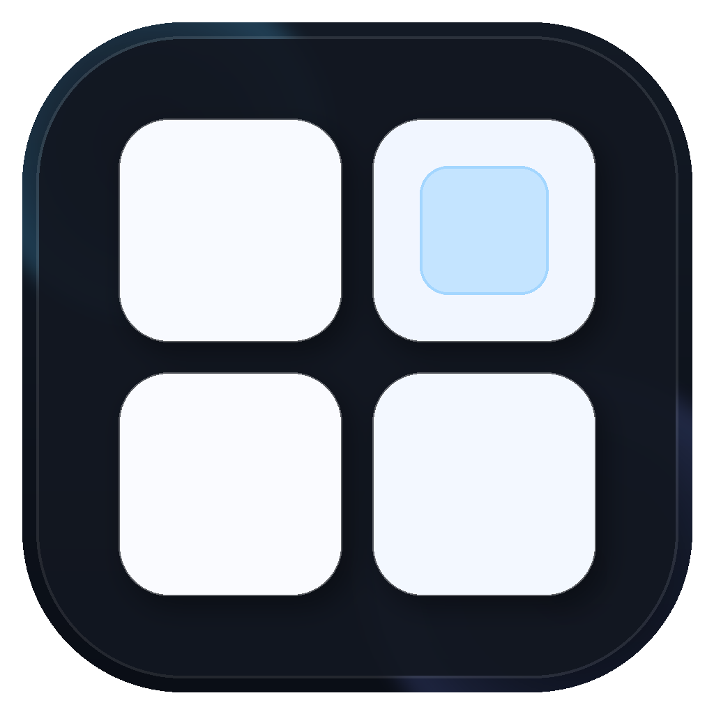
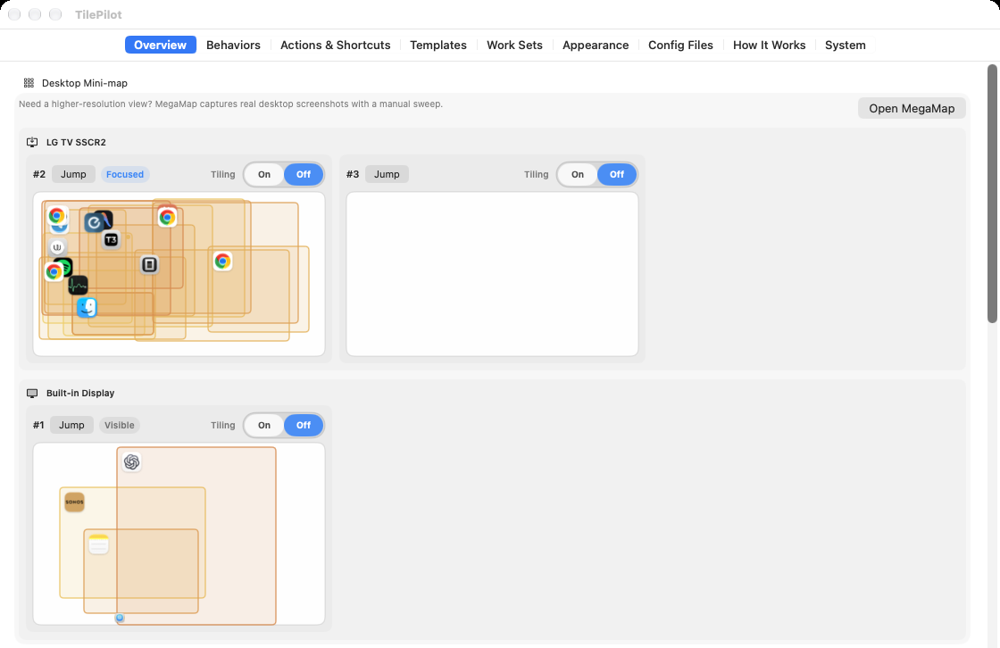
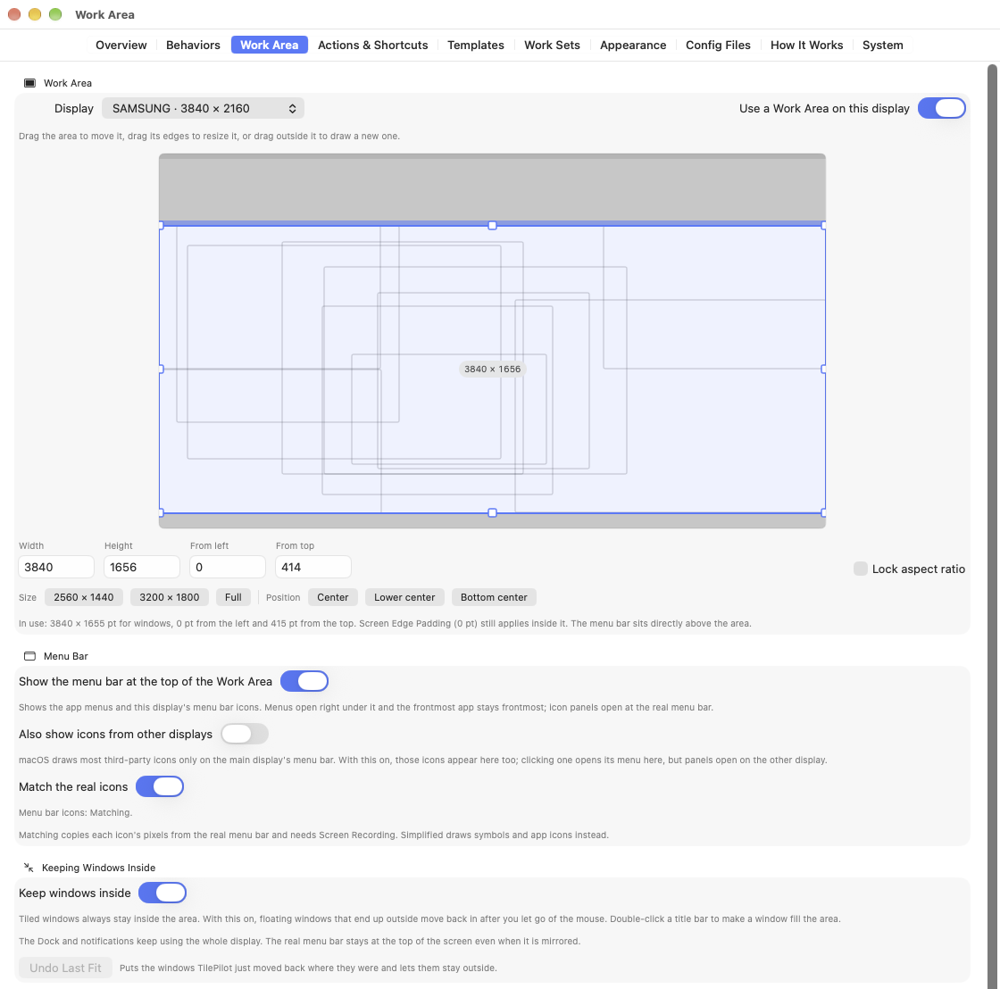
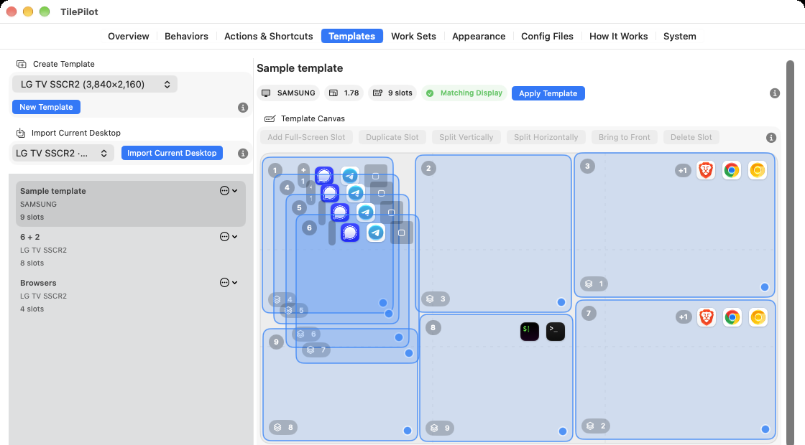
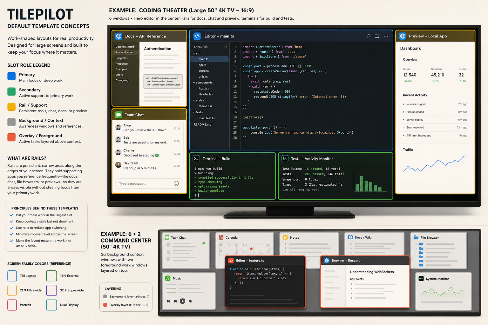
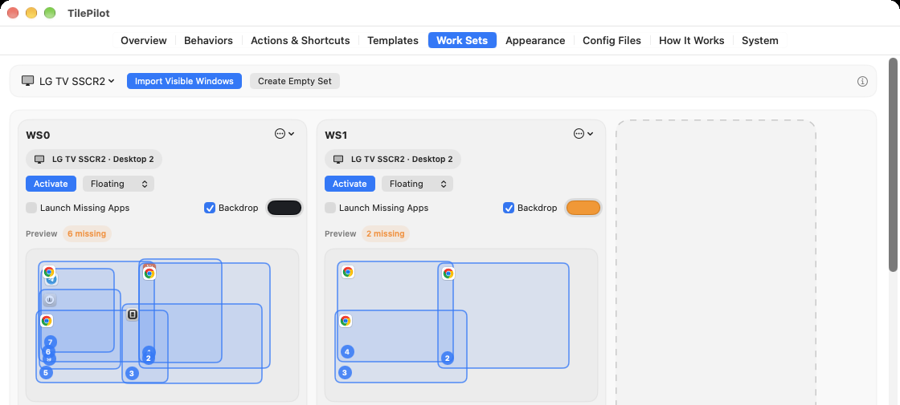
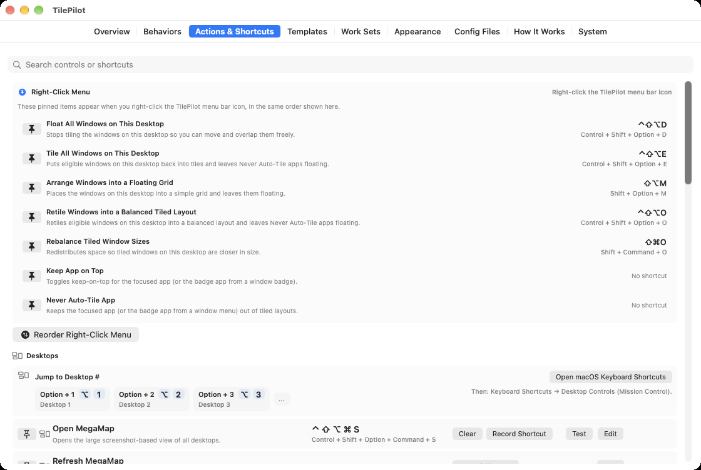
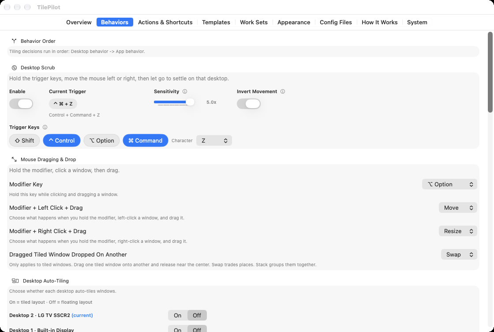
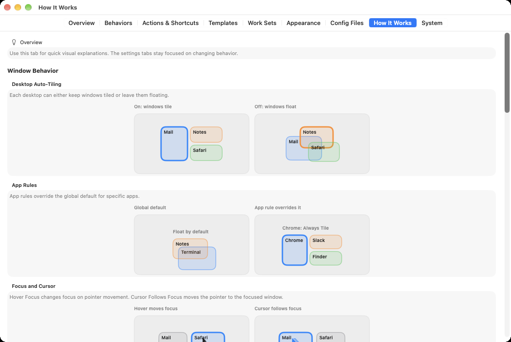

  

# TilePilot

TilePilot is a native macOS productivity tool inspired by i3.

**Website:** [autonomath.github.io/TilePilot](https://autonomath.github.io/TilePilot/) · **Download:** [latest release](https://github.com/autonomath/TilePilot/releases/latest)

It helps regular Mac users move toward a predictable, keyboard-driven window workflow without starting from a terminal-first setup. Under the hood it uses `yabai` and `skhd`, but the product goal is broader than “make the helpers run”: TilePilot is meant to make an i3-style way of working feel learnable on macOS.

## What That Means

TilePilot is built around a few ideas that come directly from the kind of workflow i3 is known for:

- stable desktops that stay predictable instead of constantly reordering themselves
- a small set of repeatable actions for focus, movement, tiling, and recovery
- tiled windows as the normal working state
- floating windows as an explicit exception when an app does not tile well
- keyboard shortcuts as the long-term path, with the GUI acting as scaffolding

TilePilot is not trying to be a literal i3 clone on macOS. It is a practical transition layer for people who want the focus and speed of an i3-style workflow without giving up native macOS setup, visibility, and recovery tools.

## What TilePilot Helps You Do

- learn and run keyboard actions from a GUI before fully relying on memory
- keep desktops and window state understandable through `Overview`, badges, and `MegaMap`
- scrub between desktops with the mouse by holding a trigger and moving left or right
- switch windows between floating and tiled states without losing track of what happened
- rebuild a messy desktop into a usable tiled layout quickly
- pick recent windows, preview their grid, reorder them, and tile only that set
- set app-level exceptions such as `Never Auto-Tile App` or `Keep App on Top`
- create reusable floating layout templates for a display and apply them to the current desktop, even when the display shape changed slightly
- import the current desktop layout into a template and constrain slots to specific apps
- save desktop-scoped Work Sets so you can bring a known group of windows back to the front
- draw a Work Area on a TV or very large display so windows stay in a comfortable rectangle, with the app menus and menu bar icons shown right above it
- manage `yabairc` and `skhdrc` safely without overwriting the rest of your config
- recover from drifted permissions, helpers, or services through Guided Setup and `System`

## Core Workflow

If you want to use TilePilot the way it is intended, the path looks like this:

1. Use `Overview` to understand what desktops and windows exist right now.
2. Learn the core actions in `Actions & Shortcuts`.
3. Let `Behaviors` define the defaults: which desktops tile, which apps never auto-tile, how focus behaves.
4. Use `Templates` when you want an exact floating layout for a display instead of a general tiled layout.
5. Use `Work Sets` when you want to save and reactivate a front-to-back pile of windows for one desktop.
6. Use `Appearance`, `MegaMap`, badges, and the right-click menu as visibility and recovery tools, not as the primary workflow.
7. Gradually rely more on the keyboard and less on the GUI.

## Main UI Areas

- `Overview`
  - the daily command center
  - shows displays, desktops, windows, focused state, and recovery when live state is degraded
- `Behaviors`
  - sets the rules behind the workflow
  - desktop tiling, desktop scrub, app rules, focus behavior, cursor behavior, and yabai mouse controls
- `Work Area`
  - limits where windows go on a large display, without changing its resolution
  - draw the area per display, keep floating windows inside, allow exceptions, and show the menu bar at the top of the area
- `Actions & Shortcuts`
  - the action catalog and shortcut learning surface
  - record shortcuts, edit them, pin frequent ones to the right-click menu, and run the recent-window picker
- `Appearance`
  - controls visual feedback and tiling spacing
  - badges, outline overlay, outline width, screen edge padding, and gap between tiled windows
- `Templates`
  - manages exact floating layouts for the current display shape
  - draw slots, split and duplicate them, import the current desktop layout, constrain slots to specific apps, and auto-fit the template when the display shape changes slightly
- `Work Sets`
  - saves and re-activates a known set of windows for one desktop
  - import visible windows, cycle between saved sets, optionally show a backdrop, restore minimized members, launch missing apps, and choose Floating, Tile, or Template layout mode
- `Config Files`
  - raw editing for managed config files and scripts
  - includes backups and restore flows
- `How It Works`
  - visual explanations of the main concepts so settings tabs can stay focused on changing behavior
- `System`
  - setup, health, update checks, diagnostics, and Guided Setup reopen paths
  - includes a Mission Control checklist for the two desktop settings TilePilot depends on most

## Screenshots

### Overview

### Work Area

### Templates

### Default Template Library

### Work Sets

### Actions & Shortcuts

### Behaviors and How It Works

  
  

## Main Layout Actions

TilePilot now names layout actions by their outcome:

- `Float All Windows on This Desktop`
  - stops tiling the eligible windows on the current desktop so you can move and overlap them freely
- `Tile All Windows on This Desktop`
  - tiles the eligible windows on the current desktop and leaves `Never Auto-Tile` apps floating
- `Arrange Windows into a Floating Grid`
  - places windows into a grid-like arrangement and leaves them floating
- `Pick Windows to Tile...`
  - opens a picker for the current desktop's recent windows, lets you choose and reorder the set, previews the placement, and applies either Floating Grid or a saved Template
- `Retile Windows into a Balanced Tiled Layout`
  - rebuilds the current desktop into a more even tiled layout
- `Rebalance Tiled Window Sizes`
  - redistributes space across the tiled windows that are already on the current desktop

This naming is deliberate: the app should tell you where windows will end up, not force you to guess.

## Pick Windows to Tile

`Pick Windows to Tile...` is for the common case where the whole desktop is too much, but the last few windows are exactly the task you want to arrange.

- opens with current-desktop windows in front-to-back order
- starts by selecting your last-used count, with `4` as the first-use default
- shows useful window titles first, especially for browsers and terminals
- lets you click rows to include or exclude windows
- lets you drag rows or preview tiles to change placement order
- previews the final placement with app icons and numbered spots
- in `Floating Grid`, fills spare cells by stretching nearby windows vertically instead of leaving holes
- defaults to `Floating Grid`; `Template` applies selected windows to compatible saved template slots

## Desktop Scrub

TilePilot also supports mouse-driven desktop scrubbing:

- hold the selected trigger keys
- move the mouse left or right to scrub between desktops
- let go of the trigger keys and macOS settles on the desktop you scrubbed to

You can enable it and change the trigger keys in `Behaviors`.

## Work Area and the Menu Bar

On a TV or a very wide display, the corners are far away and the menu bar sits at the very top edge. A Work Area is a rectangle you draw on one display in the `Work Area` tab; TilePilot then keeps windows inside it:

- tiled windows stay inside through per-desktop padding
- floating windows that end up outside move back in after you let go of the mouse
- double-clicking a title bar makes the window fill the Work Area
- `Floating Grid`, `Templates`, `Work Sets`, and `Fill Work Area` all use the same rectangle
- `Apps Allowed Outside`, `Allow Outside`, and `Undo Last Fit` cover windows that should stay where they are

Turn on `Show the menu bar at the top of the Work Area` to get the frontmost app's menus and that display's menu bar icons directly above your windows:

- menus open right under the mirrored bar, and choosing an item uses the real menu, so the app you're working in stays in front
- clicking or right-clicking an icon clicks the real one, so it behaves exactly as it does at the top of the screen; icon panels such as Wi-Fi or Battery still open at the real menu bar
- with `Match the real icons` and Screen Recording, icons are copied pixel for pixel in memory; without Screen Recording, TilePilot draws symbols and app icons
- `Also show icons from other displays` shows every display's icons once, in one row that stays put when you switch displays; icons macOS dims on the other display are shown at full brightness

The Dock, notifications, and the real menu bar keep using the whole display, and the display's resolution never changes.

## Setup

### Requirements

- macOS 13+

### Install

1. Download the latest DMG from [Releases](https://github.com/autonomath/TilePilot/releases/latest).
2. Drag `TilePilot.app` into `Applications`.
3. Open TilePilot.
4. Follow Guided Setup if helpers, permissions, or services still need attention.

### First-Time Setup

TilePilot ships with bundled `yabai` and `skhd` helpers and installs/manages them for you.

Optional approvals depend on the features you use:

- Accessibility only if macOS prompts for `TilePilot`, `yabai`, or `skhd`, if a focus/bring-to-front fallback does not work, or if you use the Work Area menu bar
- Screen Recording only if you want real `MegaMap` screenshots instead of fallback previews, or menu bar icons that match the real ones
- Start at Login if you want TilePilot available after sign-in

For the most predictable desktop-navigation behavior on macOS, review these Mission Control settings:

- `Automatically rearrange Spaces based on most recent use`: `Off`
- `Displays have separate Spaces`: `On`

Path in macOS Settings:

- `Desktop & Dock` -> `Mission Control`

## Supported Scope

TilePilot currently focuses on the everyday supported path:

- bundled helper install and recovery
- keyboard actions, shortcut learning, and right-click menu pinning
- tiled and floating window control
- recent-window picking with preview, reordering, remembered selection count, and optimized floating-grid placement
- exact floating layout templates with app-aware slot rules and display auto-fit
- desktop-scoped Work Sets with optional backdrops, minimized-window restore, missing-app launch, and per-set layout mode
- per-display Work Areas with window containment, title-bar double-click fill, and an optional menu bar at the top of the area
- a built-in default template library so new installs can try laptop, wide, ultrawide, superwide, portrait, and dual-display layouts immediately
- live desktop visibility through `Overview`, overlays, and `MegaMap`
- Mission Control checklist guidance inside `System`
- safe config management for TilePilot-managed sections

Advanced scripting-addition / SIP-dependent desktop-control workflows are intentionally out of scope for now.

## Privacy and Safety

- `MegaMap` screenshots stay in memory only for the current app session and are never written to disk.
- The Work Area menu bar's icon images are captured in memory only and are never written to disk.
- TilePilot preserves your existing `yabairc` and `skhdrc` content outside the app-managed blocks.
- TilePilot-managed config uses `TILEPILOT ...` markers so the app only edits what it owns.
- Each release ships a versioned defaults profile for fresh installs and explicit reset flows.

## Updates

- TilePilot can check GitHub Releases for newer stable versions.
- The app links you to the release page rather than silently downloading or installing anything.

## For Power Users

TilePilot still exposes the underlying tools when you want them:

- `Config Files` lets you edit `yabairc`, `skhdrc`, and referenced scripts directly.
- Legacy aliases are kept where compatibility matters, but the product surfaces use clearer outcome-based names.
- `bootstrap.sh` is treated as a legacy reset helper, not a normal day-to-day layout action.

## Developers

Build, packaging, signing, and UI context details are in:

- [Development Notes](docs/DEVELOPMENT.md)
- [GUI And Design Context](docs/GUI_DESIGN_CONTEXT.md)
